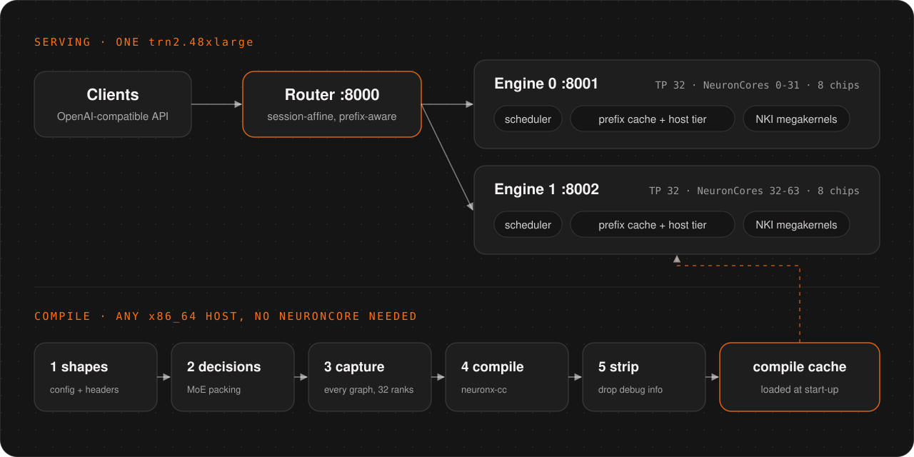

# Architecture

  <picture>
    <source media="(prefers-color-scheme: dark)" srcset="assets/architecture-dark.svg">
    <source media="(prefers-color-scheme: light)" srcset="assets/architecture-light.svg">
    
  </picture>

## Repository map

| Path | What it holds |
|---|---|
| `trnrt/__main__.py` | The CLI. `serve` runs the router plus N engines, `engine` runs one engine, `compile` runs the offline pipeline. |
| `trnrt/config.py` | `EngineConfig`: seats, bucket ladders, pool sizes and decode kernel routes. These are graph shapes. |
| `trnrt/platform.py` | Trainium2 facts, the neuronx-cc argument set and the runtime environment. |
| `trnrt/metrics.py` | Prometheus text for each engine's `/metrics`. |
| `trnrt/serve/api.py` | The OpenAI-compatible server for one engine: request validation, chat template, streaming. |
| `trnrt/serve/native.py` | SGLang's native API on one engine: `/generate`, the info and load endpoints, `/health_generate`, `/abort_request`, `/flush_cache`. |
| `trnrt/serve/router.py` | The session-affine, prefix-aware router in front of the engines, with failover. |
| `trnrt/serve/parsers.py` | GLM reasoning and tool-call parsing, streamed and whole. |
| `trnrt/serve/responses.py`, `anthropic.py` | The OpenAI Responses API and the Anthropic Messages API, translated into the chat path. |
| `trnrt/engine/engine.py` | `LLMEngine`: model build, the step loop, start and close. |
| `trnrt/engine/scheduler.py` | Continuous batching, chunked prefill and prefix-cache restores. |
| `trnrt/engine/model_runner.py` | Pads each step into a compiled bucket and runs its graph. |
| `trnrt/engine/radix_cache.py`, `kv_pool.py`, `host_cache.py`, `state_pool.py` | The prefix cache: a radix tree over FP8 KV pages, the page pool, the host-memory tier, and linear-attention state rows. |
| `trnrt/engine/spec_async.py`, `spec_synth.py` | Speculative decoding: the per-request board of device-side state the next step reads (accepted count, newest token, positions, state row, drafts), and the benchmark mode's synthetic acceptance. |
| `trnrt/engine/tp.py` | Tensor parallelism. Rank 0 drives, the other ranks follow, through shared memory or gloo. |
| `trnrt/engine/start_checks.py`, `start_lock.py`, `watchdog.py` | Host checks before start, one engine starting at a time, and turning a device hang into a clean exit. |
| `trnrt/models/` | GLM-5.3-Flash: the decoder, KDA linear attention, DSA sparse attention, mHC, the MoE, and FP8 loading. |
| `trnrt/kernels/` | NKI kernels: decode megakernels, prefill kernels, in-kernel collectives ([MEGAKERNELS.md](MEGAKERNELS.md)). |
| `trnrt/compile/` | The offline pipeline: shapes from safetensors headers, capture of every graph, a neuronx-cc farm, NEFF strip. |
| `docker/` | The image (base pinned by digest) and `check_image.py`, which checks every Neuron piece at build time. |
| `tools/` | `graph_equiv.py` (this code builds the same graphs as a reference), `check_mixed.py` (on-device output checks), `check_docs.py` (doc links). |
| `tests/` | The CPU suite ([DEVELOPMENT.md](DEVELOPMENT.md#tests)). |

## Request path

1. A client calls the router on `--port` (default 8000). A `session_id` pins the conversation to one engine.
   Without one, the router picks the engine that already holds the longest prefix of the prompt.
2. The engine's API (`serve/api.py`) validates the request and renders the chat template. It then hands the request
   to the engine thread, the only thread that touches engine state.
3. The scheduler matches the prompt against the radix cache, including pages held in host memory. It then prefills
   the rest in chunks of up to 4,096 tokens and joins the request to the running decode batch.
4. Each step, `ModelRunner` pads the batch to a compiled bucket. Rank 0 broadcasts the call and all 32 ranks run the
   same compiled graph. Sampling runs on the device.
5. Tokens stream back through the parser, which splits reasoning from content and tool calls.

## Compile pipeline

A graph depends on the weights' shapes and dtypes, plus the MoE packing decisions that `decisions` reads from a few
weight values per layer. So `trnrt compile` builds every graph on a CPU host, from the checkpoint's config,
safetensors headers and those decisions, without downloading the weights:

| Step | Does |
|---|---|
| `shapes` | Writes a shape directory from the config and safetensors headers (a few MB). |
| `decisions` | Reads the MoE packing decisions with a few range reads per layer. |
| `capture` | Traces every graph on all 32 ranks, with the serving arguments. |
| `compile` | Runs neuronx-cc on each graph, as many at once as host memory admits. |
| `strip` | Drops the NEFFs' debug info, which two engines need to fit in host memory. |

At start-up an engine loads each graph from the cache. A missing graph fails the start rather than compiling on the
serving host. A cache built for other engine arguments, another checkpoint revision, another TrnRT release or another
Neuron SDK misses.

## Adding a model family

TrnRT serves one model family today. The model-facing contract a second family must meet:

| Layer | Today | What a new family provides |
|---|---|---|
| Config | `ModelConfig.from_config_dict` dispatches on `architectures` to `glm5_next.config_from_hf` | A `config_from_hf` for its architecture names |
| Weights | `loader.ARCHITECTURES` maps the architecture to `DecoderForCausalLM`, and the loader knows GLM's tensor names | Its tensor-name map and any packing |
| Model | `ModelRunner` calls `kv_shapes`, `bind_kv_cache`, `aux_kv_shapes`, `bind_aux_kv`, `state_shapes`, `token_state_shapes`, `forward_decode`, `forward_prefill`, `layer_kind` and `group_fn` | The same methods on its model class |
| Engine | `engine.py` sets the KDA and DSA decode routes and requires recurrent state | Its own routes, or none |
| Chat | `serve/parsers.py` parses GLM's reasoning and tool-call format | A parser for its output format |

The router, the page pool, the sampler, tensor parallelism and the compile cache layout do not depend on the model.
The engine, scheduler and prefix caches still assume a hybrid model with recurrent state (the engine refuses a model
without it), and the compile steps know GLM's tensor names. A second family starts by lifting those assumptions. Open a
[model request](https://github.com/RunanywhereAI/trnrt/issues/new?template=30-model-request.yml) to discuss a family
before starting on one.
